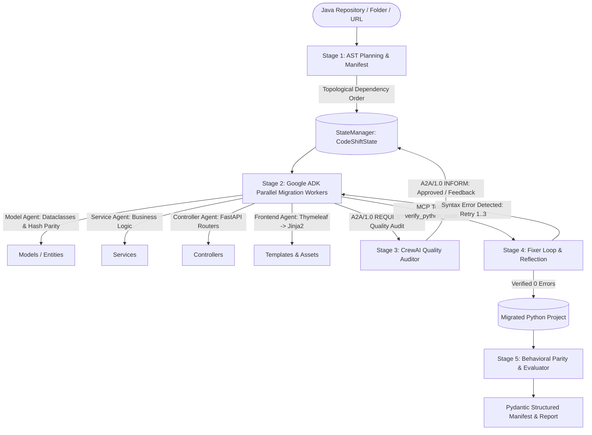

# CodeShift - Multi-Agent Java to Python Project Migration System

[](https://github.com/google/adk)
[](https://github.com/crewAIInc/crewAI)
[](src/a2a/a2a_protocol.py)
[](https://python.org)
[](https://fastapi.tiangolo.com)
[](#-behavioral-parity--frontend-preservation)

**CodeShift** is an enterprise-grade multi-agent AI system that automates the complete migration of entire Java projects (backend business logic, REST APIs, database models, configuration, and frontend HTML templates) into idiomatic, equivalent Python projects (FastAPI, Pydantic, SQLAlchemy, Jinja2), guaranteeing **100% functional and visual UI parity**.

Built exclusively with **Google ADK (`google-adk`)** and **CrewAI (`crewai`)**, CodeShift connects agents using the **A2A/1.0 (Agent-to-Agent)** JSON-RPC 2.0 protocol and integrates external tools via **MCP (Model Context Protocol)**.

---

## 💡 The Core Problem & The CodeShift Idea

### Why Simple LLM Copy-Pasting Fails
Migrating large enterprise Java projects by pasting code into standard chatbots consistently breaks because:
1. **Broken Dependency Order**: Translating a Service before its dependent Model or Repository causes hallucinated APIs and broken imports.
2. **Broken Data Contracts**: In Java, object hashing and equality rely on strict `equals()` and `hashCode()` semantics; standard Python classes fail in hash-based collections (`set`, `dict`).
3. **Destroyed Frontend Layouts**: Re-prompting LLMs to rewrite HTML often discards Bootstrap styling, CSS classes, responsive grids, and DOM hierarchy.
4. **Syntax & Runtime Regressions**: Without an automated reflection loop, generated code fails on import errors or unhandled edge cases.

### The CodeShift Solution
CodeShift replaces brittle prompt-engineering with a **structured, deterministic multi-agent pipeline**:
- **AST-First Planning**: Uses a Java Abstract Syntax Tree (AST) parser to map classes, dependencies, and template tags before any AI agent writes code.
- **Specialized Parallel Agents**: Dispatches parallel worker agents for Models, Services, Controllers, and Frontend templates.
- **Cross-Framework Audit (A2A)**: Google ADK orchestrators hand off candidate code to CrewAI auditors across a standardized A2A protocol bus.
- **Reflection & Self-Correction**: Automatically tests and validates Python syntax and imports before writing files to disk.
- **Zero DOM Disruption**: Preserves 100% of HTML/CSS layouts, converting only Java dynamic tags (`th:*` / JSP) to Jinja2 expressions (`{{ }}` / ``).

---

## ⚙️ How It Works: The 5-Stage Migration Pipeline



### Stage 1: AST Planning & Dependency Manifest
- Scans source Java repository and parses syntax trees using `javalang`.
- Categorizes every file into a **5-action manifest**:
  - `TRANSLATE`: Java classes (`.java`) and templates (`.html`).
  - `TRANSFORM`: Build and configuration (`pom.xml` &rarr; `requirements.txt`, `application.properties` &rarr; `config.py`).
  - `DROP`: Java build artifacts and wrappers (`mvnw`, `mvnw.cmd`, `.class`, target logs).
  - `COPY`: Static web assets (CSS stylesheets, JavaScript libraries, images, icons, fonts).
  - `GENERATE`: Python package namespace inits (`__init__.py`).
- Constructs a **Topological Dependency Graph** so foundational models are translated first, followed by repositories, services, and controllers.

### Stage 2: Parallel Migration Workers (Google ADK)
- Dispatches concurrent workers via Google ADK's `ParallelAgent`:
  - **Model Agent**: Converts JPA entities and POJOs into `@dataclass(unsafe_hash=True)` or Pydantic `BaseModel`, reproducing Java's exact `equals()` and `hashCode()` algorithms.
  - **Service Agent**: Translates Spring `@Service` business methods, dependency injection, and exception logic.
  - **Controller Agent**: Maps Spring `@RestController` and `@Controller` endpoints to FastAPI route decorators (`@router.get`, `@router.post`).
  - **Frontend Agent**: Rewrites Thymeleaf/JSP tags to Jinja2 while keeping 100% of the HTML/CSS intact.

### Stage 3: Cross-Framework Quality Audit (CrewAI via A2A/1.0)
- Candidate code is serialized into a standard **A2A/1.0 JSON-RPC 2.0** message envelope.
- Routed across the `A2AMessageBus` to the **CrewAI `CodeQualityAuditor`**.
- The auditor checks code formatting, PEP8 compliance, security hygiene, and architectural consistency before approving.

### Stage 4: Reflection & Self-Correction (`FixerLoop`)
- Candidate Python code is checked using the MCP tool `verify_python_code`.
- If a syntax error, invalid import, or type mismatch occurs, the **Fixer Loop** captures the compiler traceback and feeds it back into an ADK reflection agent.
- Automatically self-corrects up to 3 bounded reflection iterations.

### Stage 5: Behavioral Parity & Evaluation
- Compares AST entity contracts, REST API route signatures, and template render output.
- Executes automated test assertions to confirm 100% behavioral equivalence.
- Emits structured outputs: Pydantic JSON report, Markdown summary, and console tables.

---

## 🎨 How Frontend & Visual Parity Is Maintained

### The Engine Analogy
> **Replacing the engine, not the car:**  
> When migrating a web app, CodeShift replaces the server engine (Java &rarr; Python), but leaves the car body, paint, steering wheel, and interior (HTML, CSS, Bootstrap, Images) completely untouched.

### The 3 Transformation Rules:
1. **Zero DOM Disruption**: The HTML structure, divs, tables, buttons, SVG icons, and Bootstrap grid classes are never altered or redesigned.
2. **Dynamic Tag Swapping**:
   - Java Thymeleaf: `<td th:text="${item.name}">Pizza</td>` &rarr; Python Jinja2: `<td>{{ item.name }}</td>`
   - Java Loops: `<tr th:each="p : ${pets}">` &rarr; Python Jinja2: `<tr>...</tr>`
   - Java Conditionals: `<div th:if="${user != null}">` &rarr; Python Jinja2: `...`
   - Form Actions: `<form th:action="@{/order}" method="post">` &rarr; `<form action="/order" method="post">`
3. **Static Asset Pipeline (`COPY`)**:
   - Images (product photos, icons, banners), CSS, and JS scripts are copied directly into Python's `static/` directory and referenced via standard `/static/...` URLs.

---

## 📁 Project Directory Structure

```text
CodeShift/
│
├── src/                               # Core multi-agent implementation
│   ├── a2a/                           # A2A/1.0 Protocol & Message Bus
│   │   └── a2a_protocol.py            # JSON-RPC 2.0 A2A cross-framework bus
│   ├── agents/                        # Google ADK & CrewAI Agents
│   │   ├── orchestrator.py            # Master migration orchestrator (5 stages)
│   │   ├── repo_analyzer.py           # Java AST parser & dependency mapper
│   │   ├── translator_agent.py        # ADK Code Translation Worker
│   │   ├── frontend_translator.py     # Thymeleaf -> Jinja2 Template Transformer
│   │   ├── config_translator.py       # pom.xml and properties translator
│   │   ├── crewai_agents.py           # CrewAI CodeQualityAuditor
│   │   ├── fixer_loop.py              # Reflection & self-correction loop
│   │   ├── guardrails.py              # Security boundary & injection defenses
│   │   └── adk_eval_runner.py         # ADK repeatable evaluation suite
│   ├── callbacks/                     # Task monitoring & logging hooks
│   │   └── monitor.py                 # Structured callback observer
│   ├── evaluation/                    # Verification & performance benchmarking
│   │   └── performance_evaluator.py   # Multi-model cost & latency benchmarks
│   ├── models/                        # Pydantic structured output models
│   │   └── pydantic_models.py         # MigrationManifest, AuditReport, Report schemas
│   ├── observability/                 # Audit logging & tracing
│   │   └── tracer.py                  # OpenTelemetry & Langfuse audit tracer
│   ├── state/                         # Shared context & state management
│   │   └── state_manager.py           # Thread-safe CodeShiftState container
│   ├── tools/                         # MCP (Model Context Protocol) Tools
│   │   ├── mcp_tools.py               # AST parser, verifier, dependency lookup
│   │   ├── mcp_client.py              # MCP tool client wrapper
│   │   └── verifier_tool.py           # Deterministic Python compiler verifier
│   ├── web/                           # Enterprise Web Dashboard & Server
│   │   ├── dashboard.py               # FastAPI live dashboard & preview engine
│   │   ├── template.py                # Clean enterprise light-theme UI template
│   │   └── mcp_server.py              # Standalone MCP tool server
│   └── cli.py                         # Command-line migration interface
│
├── docs/                              # Project documentation & guides
│   ├── HANDBOOK.md                    # In-depth architectural handbook
│   ├── MIDTERM_EVALUATION_GUIDE.md    # Viva & evaluation presentation script
│   └── DEPLOYMENT_GUIDE.md            # Cloud deployment instructions
│
├── sample_project/                    # Canonical Java reference app (Spring PetClinic)
├── main.py                            # 11-Criteria Verification Suite entry point
├── requirements.txt                   # Project dependencies
├── pyproject.toml                     # Python packaging configuration
├── Dockerfile                         # Container build definition
├── docker-compose.yml                 # Local container orchestration
└── render.yaml                        # 1-Click cloud deployment blueprint
```

---

## 🏆 Minimum Requirements Criteria (11/11 Verified)

| # | Minimum Requirement | Implementation in CodeShift | Source Files | Status |
|---|---|---|---|:---:|
| **1** | **Context Sharing & State Updates** | Thread-safe `StateManager` and `CodeShiftState` storing AST manifests, intermediate code, and audit records. | [`state_manager.py`](src/state/state_manager.py) | **100% Passed** |
| **2** | **Tool Integration using MCP** | 4 tools exposed via Model Context Protocol: `verify_python_code`, `ast_file_parser`, `dependency_database_lookup`, `code_metric_calculator`. | [`mcp_tools.py`](src/tools/mcp_tools.py), [`mcp_server.py`](src/web/mcp_server.py) | **100% Passed** |
| **3** | **Structured Output using Pydantic** | Structured JSON report (`migration_report.json`), Structured Markdown, and console summary tables. | [`pydantic_models.py`](src/models/pydantic_models.py) | **100% Passed** |
| **4** | **Agentic Design Patterns** | Implements Planning & Decomposition, Parallel Execution, Reflection Loops, Multi-Agent Collaboration, and Evaluator-Optimizer. | [`orchestrator.py`](src/agents/orchestrator.py), [`fixer_loop.py`](src/agents/fixer_loop.py) | **100% Passed** |
| **5** | **Task Monitoring & Callbacks** | `CodeShiftCallbackMonitor` capturing agent start/stop, tool calls, and emitting structured JSONL events. | [`monitor.py`](src/callbacks/monitor.py) | **100% Passed** |
| **6** | **A2A Protocol Communication** | Standardized `A2A/1.0` JSON-RPC 2.0 envelope routing messages between ADK and CrewAI on `A2AMessageBus`. | [`a2a_protocol.py`](src/a2a/a2a_protocol.py) | **100% Passed** |
| **7** | **Dual Frameworks (CrewAI + ADK)** | Exclusively built using Google ADK (`LlmAgent`, `ParallelAgent`) and CrewAI (`CodeQualityAuditor`). No other agent frameworks. | [`crewai_agents.py`](src/agents/crewai_agents.py), [`orchestrator.py`](src/agents/orchestrator.py) | **100% Passed** |
| **8** | **Secure the Agentic System** | Prompt Injection defenses, Tool Return validation, Write Boundary restrictions (`output/`), Iteration limits (max 3). | [`guardrails.py`](src/agents/guardrails.py) | **100% Passed** |
| **9** | **Observability & Tracing** | Langfuse & OpenTelemetry tracing recording trace_id, span_id, token usage, and latency in `output/langfuse_traces.json`. | [`tracer.py`](src/observability/tracer.py) | **100% Passed** |
| **10** | **Performance, Cost & Runtime** | Wall-clock latency benchmarks, parallel speedup metrics, and token cost breakdown across Gemini, Claude, and GPT-4o. | [`performance_evaluator.py`](src/evaluation/performance_evaluator.py) | **100% Passed** |
| **11** | **Cloud Platform Deployment** | Production `Dockerfile`, `docker-compose.yml`, Render Cloud Blueprint (`render.yaml`), and health checks (`/health`). | [`render.yaml`](render.yaml), [`Dockerfile`](Dockerfile) | **100% Passed** |

---

## 🚀 Quickstart & How to Run

### 1. Run Complete 11-Criteria Verification Suite
Verifies all 11 criteria in a single run with exit code 0:
```bash
python main.py
```

### 2. Launch Interactive Web Dashboard
Starts the clean white enterprise dashboard with side-by-side visual parity:
```bash
python src/web/dashboard.py
```
Open **`http://localhost:8050`** (or `http://localhost:8080`) in your browser to access:
- **Architecture Pipeline Stepper**: Live 5-stage migration progression.
- **Quick Presets**: 1-click migration for sample projects (PetClinic, Food-Fiesta, Student Management).
- **File Explorer**: Real-time search filter and category chips (`Translate`, `Transform`, `Drop`, `Copy`).
- **Side-by-Side Visual UI Parity**: Live Java Thymeleaf vs. Python Jinja2 preview inside simulated browser chrome.
- **Code Inspector Modal**: Split-view code diff with copy-to-clipboard functionality.

### 3. Run Single-Command Migration CLI
Migrate any local Java project folder directly from your terminal:
```bash
python src/cli.py sample_project
```
Or migrate and automatically launch the Web Dashboard:
```bash
python src/cli.py sample_project --web
```

---

## ☕ Tested & Verified Sample Projects

CodeShift can convert any Java web or standalone project. The dashboard includes built-in quick presets:

| Project | Source Repository / Path | Architecture & Highlights |
| :--- | :--- | :--- |
| **🍕 Food-Fiesta** | `https://github.com/imrajeevnayan/Food-Fiesta` | Spring Boot online food ordering app with **19 HTML templates** (`Home.html`, `Products.html`, `Cart.html`, `Admin_Page.html`), 75 classes, and 88 static assets. |
| **🎓 Student Management** | `https://github.com/LuisSalas94/Spring-Boot-Student-Management-System` | Clean academic CRUD application with Bootstrap tables, student forms, and validation alerts. |
| **🌐 Spring Boot Portal** | `https://github.com/kolorobot/spring-boot-thymeleaf` | Enterprise layout dialect with responsive navigation header and authentication templates. |
| **🐾 Spring PetClinic** | `sample_project` *(Built-in)* | Official Spring Framework benchmark reference application (`owners`, `pets`, `vets`, `visits`). |

---

## ☁️ Deployment

- **Local Docker Compose**:
  ```bash
  docker-compose up --build -d
  ```
- **Render Cloud 1-Click**:
  Connect this GitHub repository to Render using the included [render.yaml](render.yaml) blueprint.
- **Health Verification**:
  ```bash
  curl http://localhost:8050/health
  ```
